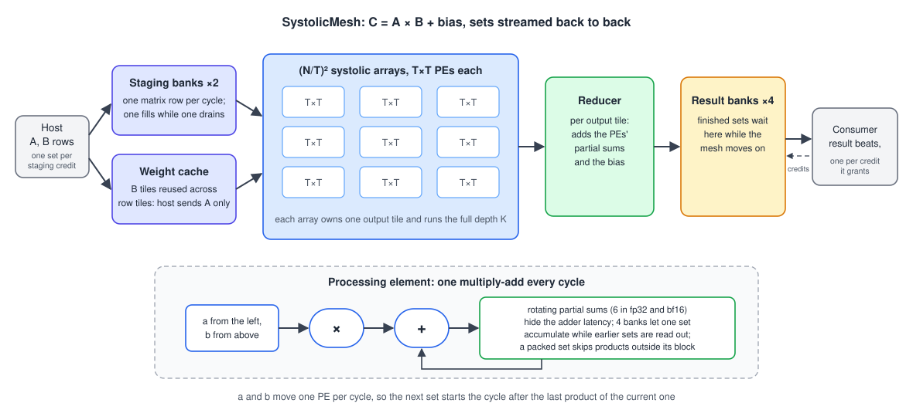

# SystolicMesh

**A scalable systolic-array matrix-multiply engine in SystemVerilog: C = A × B + bias in fp32, bf16 or int8, with sets streamed back to back.**

An N × N mesh of small T × T systolic arrays multiplies two N × N matrices with every processing element busy every cycle. It accepts the next matrix pair while the current one is still computing. SystolicMesh is the matrix engine of [SIENNA](https://github.com/SoHam-56/SIENNA), and it builds and verifies on its own.

| | |
|---|---|
| **81 ns** | to multiply two 16 × 16 matrices, start to result (fp32) |
| **7.8 TFLOPS** peak | from a 64 × 64 mesh: 4 096 multiply-accumulates every cycle |
| **89% of peak** sustained | streaming 32 × 32 matrix multiplies inside SIENNA |
| **bit-exact** | in fp32, bf16 and int8, against a Python model of the hardware |

Times assume a 950 MHz clock ([why](#performance)).

---

## Architecture



What makes it fast:

- **Each array computes a whole block of the result.** C is split into T × T blocks, and each block has its own array that runs the complete dot products, so all arrays finish together and nothing has to be combined afterwards. That takes N² processing elements, one per output element. An optional mode (`COLLAPSE_K = 0`) splits each dot product across several arrays for a few cycles less latency, at N/T times the processing elements.
- **Nothing waits for anything else.** Operands move one element per cycle through each array, so the next matrix pair enters the cycle after the last product of the current one. Two staging banks let the host load the next pair while the current one is broadcast.
- **The adder never stalls the multiplier.** A floating-point add takes several cycles. Each processing element therefore keeps several running sums and adds each new product to the next one in turn, so it accepts a product every cycle. Spare banks of running sums and of results let one matrix pair compute while earlier ones are finished and read out.
- **Weights stay on chip.** A weight cache holds blocks of B that are used again, so the host sends only A. Running sums can also stay in the processing elements from one matrix pair to the next, so a product deeper than N is built up without leaving the mesh.
- **Small jobs share the mesh.** Several independent small matrix multiplies can be packed side by side into one, each in its own block, and run together. Each processing element ignores everything outside its block, so every result is identical to running the jobs one at a time.
- **Number format chosen at build time.** One define (`make FMT=bf16` gives `+define+FMT_BF16`; none is fp32) selects fp32, bf16, or int8 with int32 sums, and with it the matching multipliers and adders from [ArithmeticLibrary](https://github.com/SoHam-56/ArithmeticLibrary), through its `fmt_mul` and `fmt_add` wrappers; widths and latencies come from its format package, so the mesh's own files name no format (`make check-fmt`), and a build holds only its format's units (`make check-hier`). Each build runs one format. bf16 multiplies bf16 numbers but keeps every running sum in fp32, and rounds each result back to bf16 only as it is written, so long dot products stay accurate: after 3 072 terms the largest error is 0.3% of the largest result, where bf16 sums were off by 50%.

---

## Performance

> All numbers are measured in cycle-accurate Verilator simulation. Times assume a **950 MHz** clock, the frequency the published TYTAN activation engine of the same project reached in a 45 nm process ([SIENNA](https://github.com/SoHam-56/SIENNA#publication)). Synthesis is planned.
>
> The latency figures were measured on 2026-10-05 (SystolicMesh e4a840a); the mesh's RTL has not changed since. The throughput inside SIENNA was measured again in the final sweep of 2026-10-25, with the same result.

**How latency is measured.** The testbench counts cycles from the start pulse to the result written to the result bank. For one set at N = 16, T = 4:

| Format | Cycles | Time |
|---|---|---|
| fp32 | 77 | 81 ns |
| bf16 | 72 | 76 ns |
| int8 | 53 | 56 ns |

The count does not depend on the data.

### Latency of one set (fp32)

| Matrix size | T = 2 | T = 4 | T = 8 | T = 16 | T = 32 | T = 64 |
|---|---|---|---|---|---|---|
| 16 × 16 | 62 ns | 81 ns | 144 ns | 372 ns | | |
| 32 × 32 | 79 ns | 98 ns | 161 ns | 388 ns | 1.25 µs | |
| 64 × 64 | | 132 ns | 195 ns | 422 ns | 1.28 µs | 4.62 µs |

Small tiles finish sooner, and doubling the matrix size adds little latency because the extra work is spread over more arrays in parallel. bf16 is 5 cycles faster and int8 24 cycles faster at every size.

### Throughput

The mesh accepts a new matrix pair every max(T + 2, K, T²) cycles, where K is the depth. That gives a peak of 486 GFLOPS at 16 × 16, 1.95 TFLOPS at 32 × 32 and 7.8 TFLOPS at 64 × 64. Inside SIENNA, streaming 32 × 32 sets from the host sustains 1.73 TFLOPS, 89% of peak.

### Compared with other matrix engines

Multiply-accumulates per cycle do not depend on the clock, so they compare designs fairly. Most edge accelerators are integer-only; SystolicMesh builds in fp32, bf16 or int8 from the same source, one format per build.

| Design | Origin | MACs per cycle | Formats | Peak, as published |
|---|---|---|---|---|
| **SystolicMesh, 64 × 64** | this work, RTL | 4 096 | fp32, bf16, int8 | 7.8 TFLOPS at 950 MHz (assumed) |
| **SystolicMesh, 32 × 32** | this work, RTL | 1 024 | fp32, bf16, int8 | 1.95 TFLOPS at 950 MHz (assumed) |
| Google TPU v1 [1] | industry, 28 nm silicon | 65 536 | int8 (int16 at reduced rate) | 92 TOPS at 700 MHz |
| NVIDIA NVDLA, full configuration [2] | industry, open RTL | 2 048 int8, 1 024 int16 / fp16 | int8, int16, fp16 | not published |
| Arm Ethos-U65 [3] | industry, licensable IP | 256 or 512 | int8, int16 | 0.5–1 TOP/s at 1 GHz |
| Arm Ethos-U55 [3] | industry, licensable IP | 32 to 256 | int8, int16 | 64–512 GOP/s at 1 GHz |
| Gemmini, default [4] | academic, open RTL | 256 | int8 with int32 sums | not published |
| Eyeriss [5] | academic, 65 nm silicon | 168 | 16-bit fixed point | 33.6 GMAC/s at 200 MHz |

[1] Jouppi et al., ISCA 2017, [arXiv:1704.04760](https://arxiv.org/abs/1704.04760) · [2] [nvdla.org](http://nvdla.org/primer.html), [nv_full spec](https://github.com/nvdla/hw/blob/nvdlav1/spec/defs/nv_full.spec) · [3] Arm [Ethos-U55](https://armkeil.blob.core.windows.net/developer/Files/pdf/product-brief/arm-ethos-u55-product-brief.pdf) and [Ethos-U65](https://armkeil.blob.core.windows.net/developer/Files/pdf/arm-ethos-u65-product-brief.pdf) product briefs · [4] Genc et al., DAC 2021, [arXiv:1911.09925](https://arxiv.org/abs/1911.09925) · [5] Chen et al., JSSC 2017, [paper](https://www.rle.mit.edu/eems/wp-content/uploads/2016/11/eyeriss_jssc_2017.pdf)

---

## Verification

`make regression` runs every test at every size: 8 × 8, 16 × 16, 32 × 32 and 64 × 64, every tile size each allows, in fp32, bf16 and int8. It generates the stimulus, builds once per tile size, and compares every output with `scripts/mesh_model.py`, a bit-exact model of the mesh's arithmetic. Every output matches:
- 11 matrix-multiply tests and the convolution tests (im2col), 19 to 23 sets each;
- every tile size;
- 8 × 8 to 64 × 64 in fp32, bf16 and int8 at every tile size, with full-depth arrays (collapse-k 1), and collapse-k 0 from 8 × 8 to 32 × 32 at every tile size (final sweep, 2026-10-25, ea85621);
- collapse-k 0 at 64 × 64 at tile sizes 8 to 64, except int8 at tile size 16, whose run did not complete (a full disk quota truncated its result file). Tile sizes 2 and 4 were not run: they need a machine with more than 256 GB of memory.

Before the simulations, the regression checks the models against references of their own, so a rounding bug shared by the RTL and `mesh_model.py` still fails:
- the fp32-to-bf16 rounding model against hand-derived corners and an integer round-to-nearest-even;
- the `fp32ToBf16` RTL against those corners and the model on 1.2 million values;
- `mesh_model.py` against float64 over 640 terms, and the stimulus words (`make model-tests`).

`make regression` runs these checks once; `mesh-regression` runs them before its simulations, and `--no-checks` skips them there.

Unit benches check a single array, the int8 element and the packed element's skip on their own.

---

## Getting started

You need Verilator 5 with a C++20 compiler (its `--timing` mode needs coroutines), and Python ≥ 3.10 with NumPy.

```bash
git clone --recursive https://github.com/SoHam-56/SystolicMesh.git
cd SystolicMesh

make regression SMALL=1                                                 # every check at N = 8 and 16, all formats
make regression                                                         # N = 8 to 64 (long: use make -jN, N for the memory, below)
make mesh-regression MATRIX_SIZE=16                                     # one N in fp32, every tile size
make mesh-regression MATRIX_SIZE=32 REGRESSION_OPTS="--format int8 --tiles 4"
make mesh-regression MATRIX_SIZE=16 REGRESSION_OPTS="--format bf16 --collapse-k 0"
```

Activate the venv in the shell that runs make: some checks call `python3` directly, and without the venv that is the system's Python, which may lack NumPy.

How `make regression` works:
- It is a list of *points*: the model checks (`model-tests`, `aril-fpu`, `aril-narrow`), and two per format, N and tile size: `bf16/N8_T2/mesh` (full-depth arrays, collapse-k 1) and `bf16/N8_T2/mesh-ck0` (depth slices and the reduce tree, collapse-k 0). `python3 regression.py --action points` lists them.
- Each point is its own make target, so `make -j4 regression SMALL=1` runs four at a time, each simulating on a quarter of the cores; `make regression/bf16/N8_T2/mesh` runs one alone. `SMALL=1` and `FMT=int8` on make's command line narrow it.
- Each point runs in a private copy of the working tree, git's files without ignored outputs (so stale stimulus or builds never reach it), under `TMPDIR` (point it at a large disk for N = 64), and writes its log to `testbenches/results/regression/`. The run ends with one table there, `regression.log`, and fails if any point fails or did not run; `make regression-summary` prints it again.
- Memory: pick N in `make -jN` so the points fit, never a bare `-j`. Measured peak of a point's largest process: collapse-k 1 about 0.4 GB at N = 8, 1 GB at 16, 3 GB at 32 and 11 GB at 64; collapse-k 0 about 0.8 GB at N = 8, 6 GB at 16 and 12 GB at 32 (but about 51 GB at 32, tile size 2). Collapse-k 0 at N = 64 needs a large machine: about 95 GB at tile size 8 and 46 GB at 16 (fp32, final sweep), about 108 GB (bf16) to 198 GB (fp32) at tile size 4, and more than 430 GB at fp32 tile size 2 (earlier runs). Its binary passes 2 GB, so it builds with the large code model (`LARGE_CODE=1`, which the regression sets).
- Run times, measured on 8-core machines: `SMALL=1` takes about 1.9 hours one point at a time and 30 minutes with every point in parallel; at 64 × 64 a point takes up to 18.5 hours alone (fp32, tile size 64, collapse-k 1), and collapse-k 0 points 5 to 8.5 hours (final sweep).

`mesh-regression`'s results go to `testbenches/results/readiness/`. To run one test by hand:

```bash
python3 scripts/matmul_tests.py --list              # or scripts/conv_tests.py
python3 scripts/matmul_tests.py --gen mm_random --matrix-size 16
make                                                # build and simulate with Verilator
```

`regression.py` drives the regression, `scripts/matmul_tests.py` and `scripts/conv_tests.py` generate stimulus, and `scripts/mesh_model.py` is the reference.

The layout: `src/` holds the RTL by function (`engine`: the processing element and accumulation unit; `mem`: the output SRAM; `top`: SystolicArray and SystolicMesh), `testbenches/top/` TB_SystolicMesh, `testbenches/units/` TB_PE, TB_PE_pack and TB_SystolicArray (`make TOP_MODULE=TB_PE` builds one), and `scripts/` the model, the stimulus writers, the hierarchy check and the self-tests.

## Standalone machine

Everything here runs on any Linux machine; nothing depends on the authors' servers.

**You need:** GNU make, git, a C++ compiler with C++20 coroutines (g++ 10 or later), Verilator 5.035 built with that compiler (the version every regression runs on), and Python 3 with the packages in `requirements.txt` (tested with Python 3.11). The released Verilator 5.052 is not supported yet: it runs SystolicMesh's regression and SIENNA's fp32 and int8 points, but stops on bf16 builds (gpnae_tail.sv), on GPNAE's lane bench (a zero-delay warning in TB_gpnae) and on the lint gates (its new warnings, and its removal of --xml-only, which check-hier reads). A Verilator configured with a g++ older than 10 omits the `-fcoroutines` its `--timing` builds need: put a `g++` wrapper that adds it first on `PATH`.

```bash
git clone --recursive https://github.com/SoHam-56/SystolicMesh.git && cd SystolicMesh
python3 -m venv .venv && . .venv/bin/activate && pip install -r requirements.txt   # every make below runs in this shell
make -j4 regression SMALL=1
```

**Choosing N in `make -jN`:** use the per-point peaks above (collapse-k 1 about 0.4 GB at N = 8 and 1 GB at 16; collapse-k 0 about 0.8 GB at 8 and 6 GB at 16), so `SMALL=1` at `-j4` fits in 32 GB and one point at a time in 16 GB. Nothing is skipped.

---

## Running with VCS

`make regression` runs on Verilator by default. `SIM=vcs` runs the same points, through the same gates, on Synopsys VCS, a 4-state simulator: it also models unknown (X) and floating (Z) bit values, which Verilator, a 2-state simulator, turns into 0 or 1.

**The authors have not run the VCS path yet** (no VCS license where it was written). The commands, gates and parsers are in place and were checked without VCS; your run is the first real one.

**You need:** `vcs` on your `PATH` with a working license, the C++ compiler VCS uses, GNU make, and Python 3 with `pip install -r requirements.txt`.

**Run it:**

```bash
make -j4 regression SIM=vcs SMALL=1
```

**Read the table** (also written to `testbenches/results/regression/regression.log`). Each row is one check: its name, its verdict, its time and its log. The last line is the overall verdict, for example `SYSTOLICMESH REGRESSION PASS: 57 of 57 gated points passed`.

| Verdict | Meaning |
|---|---|
| `PASS` | the check met the same gate as on Verilator: every output against its reference and the true function |
| `FAIL (...)` | it did not; the bracket says why, the log (path on the row) says where |
| `N/A (...)` | not used here: every point runs on VCS |

**If a row fails,** send back `testbenches/results/regression/regression.log` and the log of each failing row. A line such as `FAIL: X in output word 37 of test <name>` means the design produced an unknown value where a number was expected: a real finding for the authors, not a set-up problem. A license or compile failure shows as `FAIL (exit N)` with VCS's message in the log.

**Options:** `TRACE=1` waveforms, `XPROP=1` X-propagation, `RANDINIT=1 SEED=<n>` random register power-up instead of X. Without them a VCS build is plain: no debug access and no waveform.

What maps to what:

| Verilator | VCS | Note |
|---|---|---|
| `--binary --timing --assert` | `vcs -full64 -sverilog -timescale=1ns/1ps` | VCS runs delays and assertions natively |
| `--top-module X` | `-top X` |  |
| `-I<dir>`, `+define+X`, `-DX` (also in `EXTRA_FLAGS`) | `+incdir+<dir>`, `+define+X` |  |
| `-G<name>=<value>` (sizes, `EXTRA_FLAGS`) | `-pvalue+<top>.<name>=<value>` | top-level parameters, as with `-G` |
| `--trace` (`TRACE=1`) | `-debug_access+all +define+ENABLE_TRACE` (`TRACE=1`) | without it, `+vcs+dumpvarsoff`: no waveform |
| `--x-initial unique`, `+verilator+rand+reset+2` | `+vcs+initreg+random` (compile), `+vcs+initreg+<SEED>` (run): `RANDINIT=1 SEED=<n>` | VCS's default is X power-up, stricter than Verilator's zeros |
| (none) | `-xprop=tmerge`: `XPROP=1` | X-propagation through `if` and `case` |
| `+verilator+error+limit+N` | nothing | VCS carries on after `$error` by default |
| `-j`, `--build-jobs`, `--threads`, `SIM_THREADS` | `-j<cores>` (compile) | VCS simulates on one thread |
| `OPT_FAST=-O0`, `LARGE_CODE=1`, `USE_CCACHE` | not applicable | Verilator build workarounds |
| `/* verilator lint_off ... */`, `lint_waivers.vlt` | ignored | comments to VCS; the waiver file is Verilator's |
| `aril-narrow`: fp32ToBf16's bench and its Verilator lint | the bench on VCS | its VCS lint is ArithmeticLibrary's own lint point |

---

## Author

Soham Pramanik · [LinkedIn](https://www.linkedin.com/in/soham-pramanik-224004271/)
